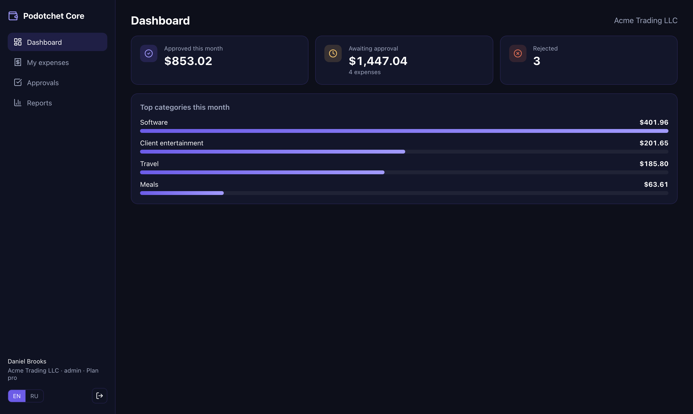
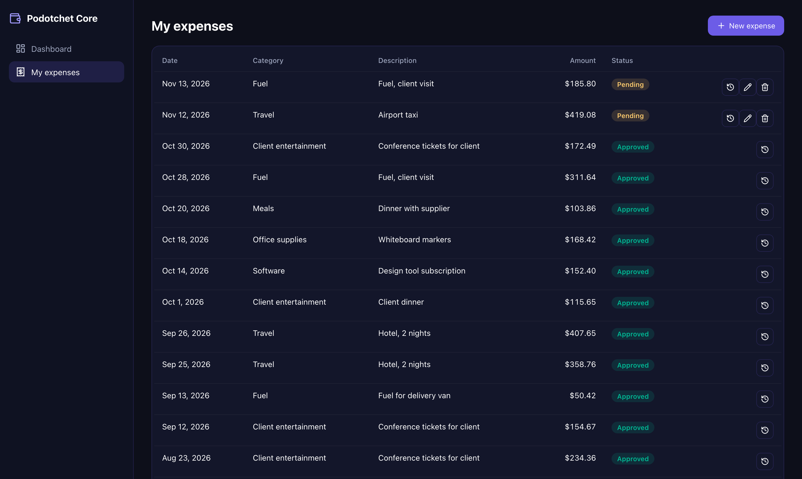
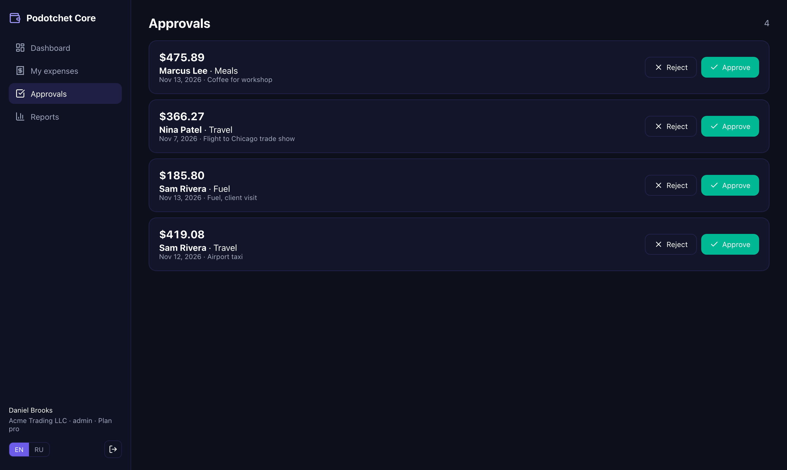
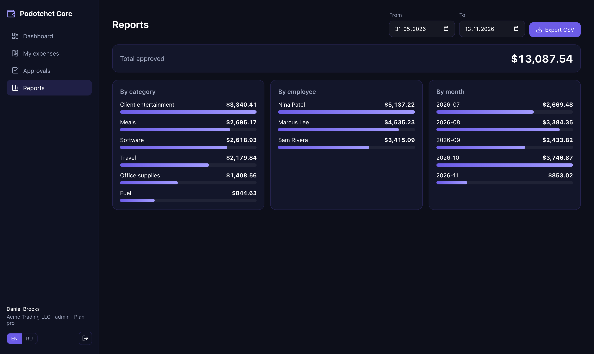
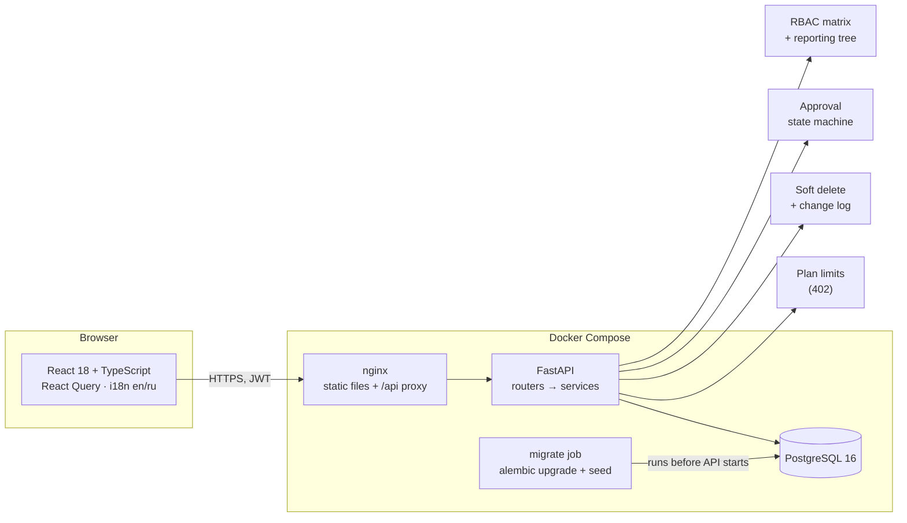

# Podotchet Core

Podotchet Core is a multi-tenant web app for tracking money that companies hand to employees for business expenses.
Employees log what they spent, managers approve or reject each expense, and owners see where the money went by category, person and month.
It is the open core of a production SaaS I built and run, rewritten with a clean history and fictional demo data.



| My expenses | Approvals | Reports |
|---|---|---|
|  |  |  |

## Architecture



## Stack

| Layer | Tech |
|---|---|
| Backend | Python 3.12, FastAPI, SQLAlchemy 2.0, Alembic, Pydantic v2 |
| Database | PostgreSQL 16 (SQLite supported for local tests) |
| Auth | JWT (python-jose), bcrypt |
| Frontend | React 18, TypeScript (strict), Vite, React Query, React Router, lucide-react |
| Infra | Docker Compose, nginx, GitHub Actions (tests on SQLite and PostgreSQL) |

## Engineering decisions

**Multi-tenancy by `org_id`, with 404 across tenants.**
Every business row carries `org_id`, and every query is scoped by the caller's organization.
Single rows are loaded through one helper, `get_in_org()`. It returns **404, not 403**, for another tenant's id, so ids can't be used to probe what exists elsewhere (IDOR).
Tests check this for read, approve and delete, and for filing an expense into another tenant's category.

**RBAC as a permission matrix plus a reporting tree.**
There are four roles: `owner`, `admin`, `auditor` and `employee`. They map to permissions in a single table (`core/rbac.py`), and routers check `can(user, Perm.X)` instead of comparing role names.
Employees see their own records and those of everyone below them in the reporting line, walked breadth-first over `supervisor_id`.
The JWT does not carry the role. It is re-read on each request, so a demotion takes effect immediately.

**Soft delete enforced globally, plus an append-only change log.**
Financial rows are never hard-deleted. A single SQLAlchemy `do_orm_execute` hook adds `deleted_at IS NULL` to every ORM SELECT on soft-deletable models. Reports and dashboards cannot forget the filter, because they never have to apply it.
Every edit writes a field-level diff to `record_change_log`, and every delete writes a full snapshot. Amounts are `NUMERIC(14,2)` in the database and decimal strings in the log and API, so there is no float rounding anywhere.
An edit that changes nothing writes no log entry.

**Approval as an explicit state machine.**
Transitions are data, not if-chains:
`pending → approved | rejected`, and `rejected → pending` when the employee edits the expense.
`approved` is terminal. Rejecting requires a reason, and nobody can review their own expense.
Status changes go through the same audit log, so an expense's history shows who approved it and when.

**Freemium plans with machine-readable errors.**
Each plan (`free`, `pro`, `business`) sets limits on users, expenses per month and CSV export.
Hitting a limit returns **HTTP 402** with a code such as `{"code": "export_locked"}`, and the UI shows an upgrade hint instead of a generic error.

**Migrations run before the server starts.**
In Docker Compose, `migrate` is a one-shot job, and the API starts only after it succeeds. A broken migration never takes down a running server.
Tests also build the schema through Alembic rather than `create_all`, so migrations are tested on every run.

## Quick start

Requires Docker.

```bash
cp .env.example .env
docker compose up --build
```

Open http://localhost:8080. All demo accounts use the password `demo1234`:

| Email | Role | Sees |
|---|---|---|
| `owner@acme.test` | owner | everything |
| `admin@acme.test` | admin | approvals, reports, users |
| `auditor@acme.test` | auditor | read-only, all data |
| `lead@acme.test` | employee | own expenses + team (Sam, Nina) |
| `sam@acme.test` | employee | own expenses |

### Run without Docker

```bash
# backend
cd backend && python3.12 -m venv .venv && . .venv/bin/activate
pip install -r requirements-dev.txt
alembic upgrade head && python seed.py
uvicorn app.main:app --reload            # http://localhost:8000/docs

# frontend (second terminal)
cd frontend && npm install && npm run dev  # http://localhost:5173
```

### Tests

```bash
cd backend && pytest -q                  # SQLite
DATABASE_URL=postgresql+psycopg2://user@localhost/podotchet_test pytest -q
```

## Project layout

```
backend/app/
  core/       security (JWT, bcrypt), rbac (roles, permissions, reporting tree), deps (auth, tenant loader)
  models/     Organization, User, Category, Expense, RecordChangeLog
  services/   approval (state machine), audit (change log), soft_delete (global filter), plans (limits)
  routers/    auth, expenses, approvals, reports, directory
backend/alembic/   migrations
backend/tests/     approval, RBAC/tenancy, soft delete/audit, plans
frontend/src/      pages (Login, Dashboard, MyExpenses, Approvals, Reports), api hooks, i18n
```

## License

[PolyForm Noncommercial 1.0.0](LICENSE.md). You may read, run and modify the code for any noncommercial purpose.
Commercial use requires a separate license, so please get in touch.
